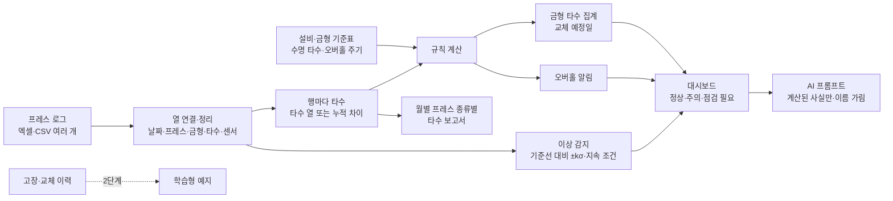

# 굴착기 카운터웨이트 프레스 예지보전 — 프로젝트 기획서

| 항목 | 내용 |
|---|---|
| 리포 | data10-01 |
| 제출자 | 조병철 |
| 직무·소속 | 협력사육성팀 — 협력사 MES 구축지원 |
| 과정 | 현장 데이터 디지털화 전문가과정 2차수 |
| 작성일 | 2026-10-20 |
| 문서 상태 | 초안 v0.1 — 수강생 제출 자료 기반 |

이 문서는 제출자가 패들릿에 올린 게시물과 그 아래 본인 댓글(`docs/source/패들릿_접수_원문.md`)을 과정 기획서 형식(10장)으로 정리한 것입니다.
첨부 파일은 없어, 열 구성·수명 기준·오버홀 주기는 모두 **가정**이며 10장에서 확인합니다.

## 1. 추진 배경과 현안

- 굴착기 카운터웨이트를 찍는 프레스는 설비 트러블이 나면 생산이 멈추고, 금형이 수명을 넘겨 쓰이면 품질·파손 위험이 커집니다.
- 지금은 프레스 진동·전류·온도·타수 데이터가 있지만, 이를 모아 **이상 징후를 미리 알리거나 금형 교체·오버홀 시기를 챙기는 체계**는 없는 것으로 보입니다(가정).
- 제출자는 협력사 MES 구축을 지원하는 직무라, 도구는 **협력사가 외부 망에서 웹 페이지로 접속해 쓸 수 있어야** 합니다(댓글 ⑥).

## 2. 목표

### 2.1 최종 목표 (제출 기대 산출물 ④ · 댓글 ⑧)

| 번호 | 결과물 |
|---|---|
| ① | 프레스 이상 감지 알림 |
| ② | 금형별 타수 집계 |
| ③ | 금형 교체주기 알림 |
| ④ | 프레스 정기 오버홀 알림 |
| ⑤ | 월별 프레스 종류별 타수 집계 보고서 |

성공하면: 프레스·금형 예지보전으로 설비 트러블을 막고, 금형 수명을 관리합니다.

### 2.2 1차 개발 목표

규칙으로 바로 계산할 수 있는 것(타수 집계·교체 주기·오버홀)을 먼저 완성하고, 이상 감지는 **통계 기준(평소 값 대비 벗어남)** 으로 「주의·점검 필요」를 표시하는 데까지 만듭니다.
고장 기록으로 배우는 예지(학습형 예측)는 고장·교체 이력이 모여야 하므로 2단계로 둡니다.

## 3. 보유 데이터

| 데이터 | 형태 | 규모·주기 | 비고(민감도 등) |
|---|---|---|---|
| 프레스 로그 — 프레스 종류·금형명·프레스 누적 타수·금형 타수·가동 시간·전류·전압·온도 | 미상(PLC·설비 화면·수기 엑셀 가운데 무엇인지 확인 필요) | 미상 | 댓글 ⑦ 「올릴 수 있는 샘플」. 설비 운전 값이라 개인정보는 없을 것으로 보임(가정) |
| 프레스 진동 | 미상 | 미상 | 게시물 ③에는 있으나 ⑦ 샘플 목록에는 없음 — 따로 수집되는지 확인 필요 |
| 금형별 타수 | 미상 | 미상 | 「금형 타수」가 그날 친 횟수인지, 교체 때 0 으로 돌아가는 누적 카운터인지 확인 필요 |
| 고장·금형 교체·오버홀 이력 | 없음(제출 자료에 언급 없음) | — | 예지 정확도를 높이려면 꼭 필요 — 10장 |
| 금형 수명 기준 타수·오버홀 주기 | 없음 | — | 1단계는 설정 화면에서 사용자가 입력 |

첨부 파일이 없어, 1단계는 위 칸 이름 그대로 만든 **가상 샘플**(프레스 P1~P4 × 90일, 금형 M-01~M-08)로 개발했습니다. 실제 로그를 받으면 열 연결만 맞춥니다.

## 4. 해결 방안 개요

| 단계 | 내용 |
|---|---|
| 수집 | 프레스 로그(엑셀·CSV), 설비·금형 기준표 |
| 정리 | 열 연결, 날짜·숫자 읽기, 같은 행 중복 제거, 타수 계산(타수 열 → 프레스 누적 차이 → 금형 누적 차이) |
| 분석 | 금형 사용 타수·사용률·교체 예정일, 오버홀 주기 사용률·예정일, 채널별 기준선 대비 이상, 월별 종류별 집계 |
| AI | 계산된 사실만 담은 프롬프트로 요약·확인 항목·정비 일정 제안(반자동, 이름은 별칭으로) |
| 산출물 | 대시보드, 금형·오버홀 화면, 이상 감지 그래프, 월별 보고서(엑셀·인쇄) |

## 5. 주요 기능

| 기능 | 설명 | 우선순위 |
|---|---|---|
| 로그 가져오기 | 엑셀·CSV 여러 개를 한꺼번에, 열 이름이 달라도 열 연결 화면에서 맞춤. CSV 는 UTF-8·CP949 자동 판별 | MVP |
| 설비·금형 기준표 | 프레스 종류, 오버홀 주기(타수·일수), 마지막 오버홀 일자, 금형 수명 기준 타수, 사용 시작일(교체일). 화면에서 고치고 엑셀로 주고받기 | MVP |
| 금형별 타수 집계 · 교체 주기 알림 | 사용 타수·사용률·남은 타수, 최근 일평균 타수로 교체 예정일 추정, 90%·14일 안이면 주의 | MVP |
| 오버홀 알림 | 타수·일수 주기 가운데 먼저 닿는 쪽, 지나면 점검 필요 | MVP |
| 이상 감지(통계 기준) | 전류·온도·진동·전압 채널마다 최근 14일을 직전 42일 기준선(중앙값·MAD)과 비교, ±3σ 를 3일 연속 넘으면 점검 필요 — 근거 숫자와 그래프 | MVP |
| 대시보드 | 프레스별 상태 카드(정상·주의·점검 필요와 근거), 금형 수명 사용률 막대, 다가오는 정비 일정 | MVP |
| 월별 프레스 종류별 타수 보고서 | 종류별·프레스별·금형별, 월별 추이, 엑셀·인쇄 | MVP |
| AI 분석(반자동) | 계산된 사실만으로 프롬프트, 프레스·금형 이름은 별칭으로 가림, 본인 키로 OpenAI 호환 서버에 보내기(선택) | MVP |
| 협력사 공유·로그인 | 협력사별 계정, 같은 데이터를 여러 사람이 봄 | 2단계 |
| 알림 보내기 | 점검 필요가 생기면 메일·메신저로 | 2단계 |
| 학습형 예지 | 고장·교체 이력으로 「고장 전에 나타나는 모양」을 배워 기준을 맞춤, 남은 수명 예측 | 2~3단계 |
| 설비 자동 수집 | PLC·설비 화면에서 로그를 자동으로 가져옴 | 3단계 |

## 6. 기대 산출물

1. **프레스·금형 예지보전 웹 도구(1단계)** — 로그 가져오기, 대시보드, 금형·오버홀·이상 감지 화면
2. **금형별 타수 집계와 교체 예정일**
3. **오버홀 알림 목록**
4. **이상 감지 결과** — 채널별 근거 숫자와 관리도 그래프
5. **월별 프레스 종류별 타수 보고서** — 엑셀·인쇄(PDF)
6. **AI 요약·정비 일정 제안 프롬프트**
7. 협력사 공유·학습형 예지 — 2단계 이후

## 7. 기술 구성

| 과정 도구 | 이 프로젝트에서 쓰는 곳 |
|---|---|
| DAY1 암묵지 자산화·전략기획 | 보전 담당자가 「이상하다」고 보는 기준, 금형 교체·오버홀 판단 기준을 꺼내 기준표로 적기 |
| DAY2 코랩(Python)·바이브코딩 | 로그 정리, 타수 계산, 기준선·관리한계 시험, 웹 도구 제작 — 1단계의 중심 |
| DAY3 멀티모달 비정형 정보화 | 수기 점검표·정비 일지 사진에서 고장·교체 이력 뽑기 (2단계) |
| DAY4 RAG (Dify, NotebookLM) | 설비 매뉴얼·정비 기준서를 근거로 이상 원인·점검 항목 질의 (2단계) |
| DAY5 Make 자동화 | 점검 필요 알림 보내기, 월별 보고서 정기 발송 (2단계) |
| 생성형 AI | 상태 요약·확인 항목·정비 일정 제안 (1단계는 반자동) |

**개발 형태**

- 1단계는 **설치 없이 브라우저에서 도는 정적 웹 페이지**입니다(HTML·JavaScript, 빌드·서버 없음). 내 PC 에서 파일로 열어도 되고, GitHub Pages 주소로 열어도 됩니다.
- **외부 망·협력사 접속(댓글 ⑥)**: GitHub Pages 주소는 회사 밖 어디서나 열립니다. 다만 1단계는 데이터를 **각자의 브라우저 안에만** 저장하므로, 협력사가 같은 주소로 들어와도 서로의 데이터는 보이지 않습니다(각자 자기 로그를 넣어 씀). 백업 JSON·기준표 엑셀로 주고받을 수는 있습니다.
- 협력사가 **같은 데이터를 함께 보려면** 로그인과 공유 DB 가 필요합니다. 2단계에서 Supabase(협력사별 계정·권한)로 만듭니다. 그때 어떤 협력사가 무엇을 볼 수 있는지(권한)를 먼저 정해야 합니다(10장).
- AI 는 도구가 직접 부르지 않는 **반자동**이 기본입니다. 계산된 숫자만 담고 프레스·금형 이름은 「설비1」「금형1」로 가립니다. 본인 키로 OpenAI 호환 서버에 바로 보내는 것도 고를 수 있습니다(키는 리포에 없음).

## 8. 개발 단계

### 1단계 — 지금 개발 가능한 부분

로그 칸 이름(댓글 ⑦)만으로 만들 수 있는 것을 먼저 만들었습니다. 고장 이력이 없으므로 이상 감지는 **통계 기준의 「주의」 표시**까지입니다.

- 로그 가져오기(엑셀·CSV 여러 개, 열 연결, 같은 행 중복 제거, 행 점검 알림)
- 타수 계산 — 타수 열이 있으면 그 값, 없으면 프레스 누적 타수 차이, 그것도 없으면 금형 누적 타수 차이. 둘 다 있으면 서로 맞는지 점검
- 설비·금형 기준표(화면 입력·엑셀 주고받기), 금형 교체·오버홀 완료 기록 버튼
- 금형별 타수 집계·교체 예정일(최근 14일 일평균), 오버홀 알림(타수·일수)
- 이상 감지 — 채널별 기준선(중앙값·MAD 또는 평균·표준편차), ±kσ 관리한계, 지속 조건(연속 일수), 근거 숫자, 관리도 그래프. 기준값은 설정에서 바꿈
- 대시보드 — 프레스별 정상·주의·점검 필요, 금형 수명 사용률, 다가오는 정비 일정
- 월별 프레스 종류별 타수 보고서(엑셀·인쇄)
- AI 프롬프트(사실만, 이름 가림, 답의 별칭 되돌리기)
- 가상 샘플(프레스 4대 × 90일)에 세 가지를 심어 확인: 금형 M-05 수명 임박(주의), P2 마지막 2주 전류·온도 상승(점검 필요), P4 오버홀 주기 지남(점검 필요)

### 2단계

- 실제 로그로 열 연결·단위·타수 계산 방식 확정, 기준선 구간·k·지속 일수를 실제 잡음에 맞춤
- 고장·금형 교체·오버홀 이력을 받아 이상 감지 결과와 맞춰 보기(얼마나 미리 알렸는지, 헛경보가 얼마나 되는지)
- 협력사 공유 — Supabase 로그인·협력사별 권한·공유 DB
- 점검 필요 알림 보내기(Make 등)

### 3단계

- 학습형 예지 — 고장 전 패턴 학습, 금형 남은 수명 예측
- PLC·설비 화면에서 로그 자동 수집

## 9. 기대 효과

- **설비 트러블 예방** — 전류·온도처럼 서서히 오르는 변화를 고장 전에 「점검 필요」로 드러냅니다.
- **금형 수명 관리** — 금형마다 사용률과 교체 예정일을 보며 교체를 미리 준비합니다.
- **오버홀 누락 방지** — 주기를 넘긴 프레스를 빠짐없이 표시합니다.
- **보고 시간 단축** — 월별 프레스 종류별 타수 보고서를 같은 형식으로 바로 냅니다.

제출 자료에는 정량 수치가 없어 이 문서도 수치를 적지 않습니다.

## 10. 확인 필요 사항

**샘플 데이터 (필수)**

1. 실제 로그 견본 몇십 행 — 시각(또는 일자)·프레스·금형·타수·전류·전압·온도(·진동). 값을 가려도 됩니다. 한 행이 하루인지, 시각별(몇 분·몇 시간 간격)인지
2. 고장·금형 교체·오버홀 이력 — 언제, 어느 프레스·금형, 무엇이 고장났는지(있는 만큼). 학습형 예지와 이상 감지 기준을 맞추는 데 꼭 필요합니다
3. 금형별 수명 기준 타수, 프레스 종류별 오버홀 주기(타수 또는 개월)
4. 「금형 타수」가 그날 친 횟수인지, 교체 때 0 으로 돌아가는 누적 카운터인지 / 「가동 시간」 단위(시간·분)
5. 진동은 따로 수집되는지(⑦ 샘플 목록에 없음), 어떤 값(RMS·피크, 단위)인지

**데이터 출처·환경**

6. 데이터를 어디서 꺼내는지 — PLC, 설비 화면 내보내기, 수기 엑셀 가운데 무엇이고, 얼마나 자주 꺼낼 수 있는지
7. 협력사 계정·공유 방식 — 협력사마다 자기 프레스만 보는지, 협력사육성팀이 전체를 보는지, 몇 곳·몇 명인지
8. 외부 AI(ChatGPT 등)에 설비 로그 요약을 보내도 되는지, 회사에서 허용한 AI 가 있는지
